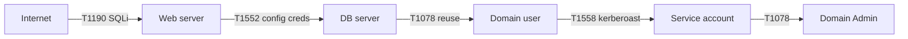

# Reporting

## 1. Structure

```
report.md
├── Executive summary        (1 page, non-technical, business risk)
├── Scope & methodology      (assets, dates, tools, RoE deviations)
├── Attack narrative         (chained story from initial access to objective)
├── Findings                 (ordered by severity)
├── Remediation roadmap      (prioritized, effort vs impact)
└── Appendices               (tool output, evidence index, glossary)
```

## 2. Finding template

```markdown
## F-01 — SQL Injection in /api/v1/report?id=

**Severity:** Critical (CVSS 3.1: 9.8 — AV:N/AC:L/PR:N/UI:N/S:U/C:H/I:H/A:H)
**Asset:** https://app.target.com
**Affected component:** `reports.php` line 42, `id` parameter

### Summary
User-controlled `id` is concatenated into a SQL query without parameterization,
allowing arbitrary query execution as the application database user.

### Preconditions
Authenticated as any role (free tier sufficient).

### Steps to reproduce
1. Authenticate and obtain a session cookie.
2. Send the request in `poc/F-01/request.txt`.
3. Observe the response in `poc/F-01/response.txt` containing the `version()` output.

### Evidence
- `poc/F-01/request.txt`, `poc/F-01/response.txt`, `poc/F-01/screenshot.png`

### Impact
Full read/write access to the customer database, including PII of ~40k users.
Combined with F-04 this yields OS-level command execution on the app server.

### Remediation
Use parameterized queries / prepared statements. Add a WAF rule as a stopgap.
Verify with a retest of the exact payload.

### References
OWASP A03:2021, CWE-89, MITRE T1190
```

## 3. Severity

CVSS 3.1 base vector, then adjust with environmental context (data sensitivity, exposure, compensating controls). Do not inflate: a self-XSS on a marketing page is not high. Do not deflate: an authenticated SQLi that reads all PII is critical regardless of the login.

| Rating | Typical |
| --- | --- |
| Critical | Pre-auth RCE, mass PII exposure, domain/cloud admin takeover |
| High | Auth RCE, SQLi with data access, IDOR on sensitive records, privesc to admin |
| Medium | Stored XSS with session impact, SSRF to internal metadata, auth bypass on low-value role |
| Low | Reflected XSS, verbose errors, missing headers, weak TLS |
| Info | Best-practice deviations without direct impact |

## 4. Attack narrative

Chain findings to show the path: `external foothold → credential access → lateral → objective`. One diagram (draw.io / mermaid) beats three pages of prose. Name the techniques with ATT&CK IDs (`T1190`, `T1078`, `T1003.001`, `T1550.002`).



## 5. Evidence hygiene

- Exact HTTP request/response, not screenshots alone.
- Timestamps in UTC, tool version recorded.
- Redact PII; keep hashes or record counts instead.
- Every finding maps to a file path under `poc/`.
- Note any deviation from RoE, with the approval reference.

## 6. Retest

After remediation: re-run the exact PoC, record pass/fail, note partial fixes and new attack surface introduced by the fix. Append to the report; never rewrite the original finding.

## 7. Deliverable quality bar

- A competent engineer can reproduce every finding from the report alone.
- Exec summary readable by a non-technical executive in five minutes.
- No finding without impact.
- No severity without a vector.
- No recommendation that the client cannot action.
